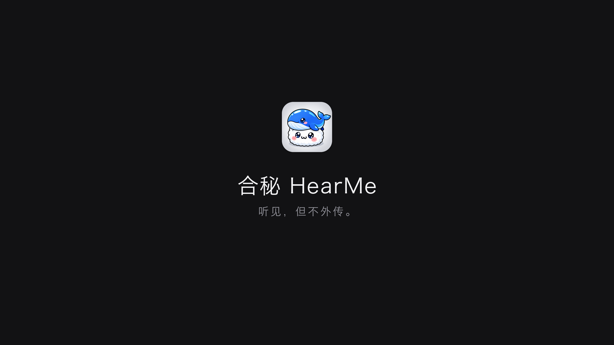

# 合秘 HearMe


> 本地实时会议字幕。把会议里**对方说的话**实时转成文字，叠在屏幕上。
> 音频只在这台 Mac 上处理，不联网、不上传、不要账号。

macOS 14+ · Apple Silicon · 纯 Swift 主程序，零 Swift 依赖
（Whisper 精修是可选功能，需要本地 Python + mlx-whisper）

**▶ [看演示片（55 秒，带解说和背景音乐）](Demo/recording/合秘HearMe-演示片.mp4)**

> 背景音乐是用 `Scripts/make_music.py` 合成的正弦波和弦，没有版权问题。



---

## 名字

**HearMe** 读起来像「合秘」——听见我，也听见秘密。
产品做的事也一样：把别人说的话听见、记下，但不外传。

---

## 它解决什么问题

线上会议（腾讯会议 / 飞书 / Zoom / Meet / 浏览器）里，最怕**没听清一句就断片**。
系统自带的实时字幕只支持有限的几种语言、样式固定、且在很多场景不出现。

合秘 做三件事：

1. **抓系统声音** —— 不装虚拟声卡、不改输出设备、不需要 Loopback
2. **离线识别** —— 用 Apple 的 Speech 框架，中英文都能跑，音频不出本机
3. **浮窗字幕** —— 无边框、置顶、可穿透鼠标，叠在会议窗口底部；**文字可选中、可一键复制**

额外：
- 整个会议自动存成 Markdown，带时间戳和说话人
- **自动生成字幕文件**（SRT / VTT / ASS），会议进行中就实时刷新
- 散会后可以一键用**本地 Whisper large-v3-turbo 精修**，准确率明显高于实时识别

---

## 快速开始

```bash
git clone <repo> && cd HearMe
./build.sh                    # 编译 + 打包 + 自签名
open .build/HearMe.app       # 首次运行会请求两个权限
```

首次启动需要授权：

| 权限 | 为什么需要 |
|---|---|
| **屏幕与系统录音** | macOS 唯一允许 App 读取"其他 App 播放的声音"的通道。这是系统限制，不是要看你屏幕 |
| **语音识别** | 调用系统离线 ASR |
| 麦克风（可选） | 想同时记下自己的发言时才需要 |

> 授权后建议**退出重开一次**，让 TCC 缓存刷新。

---

## 使用

1. 点 **开始转写**（或 `⇧⌘L`）
2. 点工具栏右上角方框图标（或 `⇧⌘K`）打开**字幕浮窗**
3. 拖到会议窗口底部（**拖顶栏那一行**，正文区域留给你选字）
4. 点浮窗上的光标图标切换**鼠标穿透**（这样不会挡住会议按钮）

### 复制（转写文字随时可复制）

**主窗口**：整段转写是 `NSTextView`，任何时候都能拖选、`⌘A`、`⌘C`、`⌘F` 搜索。

| 方式 | 位置 |
|---|---|
| 拖选任意文字 → `⌘C` | 主窗口 / 浮窗 |
| **复制全部** | 主窗口右上角、底部、`⇧⌘C` |
| 复制最新一句 | 浮窗顶栏倒数第二个图标 |
| **自动复制到剪贴板** | 菜单 → 勾选后每句定稿自动写入 |

**关键设计：选区在实时追加时不会丢。**

普通 `List` / `LazyVStack` 每次数据变化都会重建视图，用户选中的文字会瞬间消失——这在会议场景里是致命的，因为你永远在"刚选中就被新句子冲掉"的状态。

所以主窗口用 `NSTextView`，并在每次内容更新时**记录并恢复 `selectedRange()`**：

```swift
let savedRange = tv.selectedRange()
let hadSelection = savedRange.length > 0
tv.textStorage?.setAttributedString(attr)
if hadSelection, savedRange.location + savedRange.length <= newText.utf16.count {
    tv.setSelectedRange(savedRange)     // 选区原样保留
}
// 有选区时绝不自动滚动，否则会打断拖选
if !hadSelection && autoScroll { tv.scrollToEndOfDocument(nil) }
```

实测：选中"规划模型接入"，再追加 1 行、2 行，选区依然是那 6 个字。

> 浮窗开了「鼠标穿透」后收不到点击，先点一下光标图标关掉它再选字。

菜单 `转写` 里有全部快捷键。转写内容自动存到
`~/Library/Application Support/HearMe/YYYY-MM-DD-HHmm/会议.md`
（同目录还有字幕文件和原始录音）

---

## Whisper 精修（可选，但强烈推荐）

实时识别用 Apple 的设备端模型是为了**低延迟**，代价是专业术语和中英混说容易错。
散会后点一下 **「Whisper 精修」**（或 `⇧⌘R`），用本地的 Whisper large-v3-turbo 把录音重转一遍，替换掉原来的结果。

实测对比（同一段会议录音）：

| | 结果 |
|---|---|
| Apple 实时 | 架构设计规划模型接入`Zack`智能体`焊`评测能力 |
| **Whisper 精修** | 负责AI总体架构设计、规划模型接入、智能体和评测能力。 |

| | 结果 |
|---|---|
| Apple 实时 | 制定`它`应用建设规范`焊`技术选型原则推动上线`转入`机制 |
| **Whisper 精修** | 制定AI应用建设规范和技术选型原则。推动上线准入机制。 |

速度：**2 分钟音频约 2 秒**（M5，large-v3-turbo）。

### 装一次

```bash
# 需要 uv（brew install uv）或任意 Python 3.12
uv venv --python 3.12 .venv
uv pip install --python .venv/bin/python mlx-whisper
```

### 模型放哪

程序按这个顺序找模型，第一个存在的就用：

1. 环境变量 `HEARME_WHISPER_MODEL`
2. 用户设置 `whisperModelPath`（`defaults write local.hearme.app whisperModelPath <路径>`）
3. HuggingFace 缓存 `~/.cache/huggingface/hub/models--mlx-community--whisper-large-v3-turbo/snapshots`
4. LM Studio 目录 `~/.lmstudio/models/mlx-community/whisper-large-v3-turbo`
5. 内置位置 `~/Library/Application Support/HearMe/whisper-large-v3-turbo`

**最省事的方式**是用 HuggingFace 直接拉：

```bash
huggingface-cli download mlx-community/whisper-large-v3-turbo
```

它会落到 `~/.cache/huggingface/hub/...`，程序自动认。

> 模型是 1.5GB safetensors，`n_mels=128` / `n_audio_layer=32` / `n_text_layer=4`，正是 turbo 架构。
> 如果你用 LM Studio 下载过，直接指过去也行，**不需要**通过 LM Studio 启动。

### 为什么需要 VAD

Whisper 在长静音段会**产生幻觉**——它会把训练数据里的字幕水印吐出来：

```
你能介绍一下你设计的AI平台整体架构吗?我一般把它拆成6能力加两横两走。
请不吝点赞 订阅 转发 打赏支持明镜与点点栏目请不吝点赞 订阅 转发 打赏支持明镜与点点栏目...
```

调 `temperature` / `no_speech_threshold` / `hallucination_silence_threshold` 都压不干净。
**唯一可靠的办法是先切掉静音**：`Scripts/refine.py` 里做能量 VAD，
把音频切成真正的语音段，逐段送进 Whisper。这样既消灭幻觉，又快很多（只算有声部分）。

再加一层文本过滤兜底（`is_hallucination`）：水印关键词、短片段、重复退化（"装置装置装置…"）、字符种类过少。

---

## 字幕文件

每次转写都会自动生成字幕，和 Markdown 同目录同名：

```
~/Library/Application Support/HearMe/
└── 2026-10-22-1017/          ← 一场会议一个文件夹
    ├── 会议.md                ← 转写全文（Markdown 表格）
    ├── 会议.srt               ← 字幕（默认生成）
    ├── 会议.vtt
    ├── 系统声音.wav           ← 对方的声音（16k 单声道）
    └── 麦克风.wav             ← 我的声音（开启麦克风时）
```

同一分钟内开始第二场会自动加序号（`2026-10-22-1017-2`），不会覆盖。

| 格式 | 用在哪 |
|---|---|
| **SRT** | 几乎所有播放器、剪辑软件（Premiere / Final Cut / 剪映） |
| **VTT** | 网页 `<track>`、YouTube、HTML5 播放器 |
| **ASS** | 需要样式控制时（字号、描边、位置已预设成 1080p 可读） |

菜单 → **字幕文件** 里可以勾选要哪些格式、开关「会议中实时刷新」、开关「包含说话人」。
菜单 → **历史会议** 可以直接跳到任意一场的文件夹。

### 一个必须解决的问题：结束时间从哪来

ASR 只告诉你"这句话什么时候开始"，没有结束时间。而 SRT 必须有 `start --> end`。

三层处理：

1. **真实结束时间**：`TranscriptLine.endAt`，采集层在下一句到达时回填
2. **长度估算**：中文按 4.5 字/秒，英文按 12 字符/秒
3. **不能越过下一句**：`end = min(end, nextStart - 0.08)`，否则字幕会重叠

会议停止时还会补一次 `finishLastLine()`，给最后一句一个合理的结尾。

### 长句要拆，但不能切坏词

一句 30 秒的话直接做成一条字幕，观众会看得很难受。所以要拆：

- 优先在标点处断（`，。；！？`）
- 实在没有标点，硬切时**避开英文单词中间**（`Agent` 不能变成 `Ag|ent`）
- 拆分后**每一片都补回说话人前缀**，否则后面几条不知道是谁在说

```
4
00:00:12,000 --> 00:00:18,720
对方：六能力指的是模型接入、RAG、Agent运行时、
评测、MLOps和AI安全，两横是数据层和基础设施层，

5
00:00:18,800 --> 00:00:20,000
对方：两纵是审计和成本。
```

时间按字数比例分配，保证整段的语速一致，不会出现前半段飞快、后半段拖沓。

---

## 原理

### 一、怎么拿到"对方的声音"

macOS 不允许普通 App 直接读系统混音（那是安全边界）。合法路径只有一条：

```
ScreenCaptureKit (SCStream, capturesAudio = true)
        ↓  48kHz Float32 单声道 PCM
   CMSampleBuffer
        ↓  拷贝成 AVAudioPCMBuffer
   AVAudioConverter  →  16kHz Float32 单声道
        ↓
   SFSpeechAudioBufferRecognitionRequest.append()
```

关键点：

- `SCStreamConfiguration.capturesAudio = true` —— SCK 从 macOS 13 起支持只取音频。
- `cfg.width/height = 2`、`minimumFrameInterval = 1s` —— 把视频压到最小，只要音频流，开销几乎为零。
- `excludesCurrentProcessAudio = true` —— 不录自己 App 发出的声音，避免回授。
- 这套方案抓的是**整个系统的输出**，所以腾讯会议、飞书、Zoom、B 站、本地播放器一视同仁，不需要为每个 App 做适配。

麦克风走另一条独立链路：`AVAudioEngine.inputNode.installTap`，和系统声音互不干扰，因此可以做**双声道分离**（对方 / 我）。

### 二、怎么把流式音频变成句子

Apple 的 `SFSpeechRecognizer` 是**有状态、有时长上限**的，不能一口气喂完整场会议。所以每一路都跑一个 `SpeechLane`，做三件事：

**1. 分段（segment）**

一段识别任务最多跑 45 秒，或者遇到静音就主动收尾：

```swift
let threshold = max(peak * 0.16, 0.02)   // 自适应阈值
if level < threshold {
    if quietSince == nil { quietSince = now }
    if now - quietSince > 1.5, !pendingText.isEmpty {
        restart()   // 断句
    }
} else { quietSince = nil }
```

阈值不是写死的：它跟随最近的**峰值音量**衰减（`peak * 0.16`，下限 0.02）。
写死阈值在实际环境里必然失败——不同会议软件的音量、系统音量、降噪开关差异极大，实测底噪能到 0.15。

**2. 收尾（flush）**

`request.endAudio()` 之后等 `isFinal`，最多等 2 秒；如果识别器没回，就把最后一条 partial 当结果发出去。
**这一步很容易漏**：不处理的话，用户点"停止"时最后一句话永远丢失。

**3. 合并（merge）**

说话人中途换气会被切成两段，所以存储层做二次合并：

```swift
if 同一说话人 && 间隔 < 3s && 上一句没有以 。！？ 结尾 && 长度 < 200 {
    合并成一句
}
```

### 三、怎么区分"对方"和"我"

两条完全独立的 `SpeechLane`，各自持有自己的 `SFSpeechAudioBufferRecognitionRequest`。
识别结果带上 speaker 标记后进同一个 `TranscriptStore`，按时间排序。

这比"用一个识别器 + 声纹分离"简单得多，而且准确——因为两路音频物理上就是分开的。

### 四、离线 vs 在线

```swift
if recognizer.supportsOnDeviceRecognition {
    req.requiresOnDeviceRecognition = true
}
```

强制走设备端模型。代价是准确率略低于云端，换来的是**音频一个字节都不出本机**。
对面试、内部会议、涉密讨论，这个交换是值得的。

### 五、领域词表

```swift
req.contextualStrings = ["架构师", "智能体", "RAG", "Agent", "向量库", "微服务", ...]
```

这是**性价比最高的准确率优化**。ASR 模型对专有名词、中英混说（"RAG 召回"、"Agent 编排"）容易错，
喂一份领域词表能把这类错误降一个量级。词表在 `SpeechLane.domainVocabulary`，按你的行业改。

### 六、浮窗怎么做到"不碍事"

```swift
NSPanel(
    styleMask: [.nonactivatingPanel, .fullSizeContentView, .utilityWindow],
    ...
)
win.level = .floating                              // 永远在会议窗口之上
win.collectionBehavior = [.canJoinAllSpaces, .fullScreenAuxiliary, .stationary]
win.ignoresMouseEvents = true                      // 鼠标穿透，点到的是下面的会议窗口
```

`.nonactivatingPanel` 保证点浮窗不会把会议窗口顶到后面；
`.fullScreenAuxiliary` 保证会议全屏时浮窗还在；
`ignoresMouseEvents` 是"能看见但摸不到"，这是叠在别人窗口上的关键。

**但"能选字"和"能穿透"是冲突的**，所以这里做了三件事：

1. `canBecomeKey` 返回 `true`（`NSPanel` 默认是 false）—— 否则窗口拿不到焦点，`⌘C` 根本不会触发
2. `isMovableByWindowBackground = false` —— 否则在文字上拖动会变成"移动窗口"，永远选不中字
3. 顶栏单独放一个透明 `NSView` 作为拖动区（`mouseDown` → `performDrag`）—— 拖动和选字各占一块区域，互不干扰

正文的每个 `Text` 都加 `.textSelection(.enabled)`，并提供一个"复制当前行"按钮兜底。

### 七、快捷键

| 操作 | 快捷键 |
|---|---|
| 开始 / 停止 | `⇧⌘L` |
| 显示 / 隐藏浮窗 | `⇧⌘K` |
| 复制当前字幕 | `⇧⌘C` |
| Whisper 精修 | `⇧⌘R` |
| 复制全文 | `⇧⌘C` |
| 导出字幕 | `⇧⌘S` |
| 导出为文本 | `⌘E` |

### 八、签名与权限

TCC 权限**绑定代码签名**。ad-hoc 签名每次重编译指纹都变，权限就全丢了——这是开发期最烦的坑。

`build.sh` 因此会优先使用一个固定的本地自签证书（`HearMe Local Dev`）：

```bash
security find-identity -v -p codesigning | grep "HearMe Local Dev"
```

有则用它签，没有才退回 ad-hoc。证书只需创建一次（见下方"开发者备注"），之后重编译不用重新授权。

---

## 项目结构

```
Sources/
├── HearMeApp.swift      App 入口、菜单、生命周期
├── AppState.swift        全局状态：权限、启停、采集器编排
├── AudioCapture.swift    ★ 核心：SpeechLane（分段识别）+ SystemAudioCapture + MicCapture
├── TranscriptModel.swift 转写数据模型、Markdown 落盘、句子合并
├── ContentView.swift     主窗口
├── PlainTextPane.swift   ★ NSTextView 承载全文，选区不丢
├── CaptionWindow.swift   悬浮字幕窗
├── SubtitleExporter.swift ★ SRT / VTT / ASS 生成，时间轴推断
├── WhisperRefiner.swift  调用本地 Whisper 精修
├── SelfTest.swift        --perm-status 权限诊断
└── DebugLog.swift        调试日志（HEARME_DEBUG=1 开启）

Scripts/
├── refine.py             ★ VAD 切分 + Whisper 逐段识别 + 幻觉过滤
└── make_icon.py          从原图生成 .icns（含圆角与投影）

Icon/
├── source.png            原图
├── icon_1024.png         成品 1024
└── AppIcon.icns          打包用
```

`AudioCapture.swift` 是全项目的核心，想改识别行为基本都在这里。

---

## 已知限制

- **只能抓系统输出**：如果会议软件走了独立声卡、或者对方声音只从耳机出而你拔了耳机，可能抓不到。
- **说话人分离只分两路**：对方多人说话时不会区分是谁。
- **ASR 准确率**：Apple 设备端模型对中英混说、专业术语仍会出错 → 用 Whisper 精修补上。
- **Whisper 也非完美**：`RAG` 这种缩写常被听成 `Zack`/`Zag`，是 TTS 发音与模型先验共同导致，词表 prompt 也压不住。真人说话通常好一些。
- **长会议**：连续跑 2 小时以上，建议中途停一次再开，避免识别器状态累积。
- **字幕时间轴**：没有真实结束时间时按字数估算，长句拆分的时间分配是近似值。用 Whisper 精修后时间轴会准得多（Whisper 给的是真实 segment 边界）。
- **浮窗选字**：必须关掉「鼠标穿透」才能选中；这是有意设计，否则浮窗会挡住会议窗口的所有点击。

---

## 开发者备注

### 创建固定的签名证书（只需一次）

```bash
cd .signing
openssl req -x509 -newkey rsa:2048 -keyout key.pem -out cert.pem -days 3650 -nodes -config cert.cnf
openssl pkcs12 -export -legacy -inkey key.pem -in cert.pem -out id.p12 -passout pass:hearme -name "HearMe Local Dev"
security import id.p12 -k ~/Library/Keychains/login.keychain-db -P hearme -T /usr/bin/codesign -A
security add-trusted-cert -r trustRoot -p codeSign -k ~/Library/Keychains/login.keychain-db cert.pem
```

`-legacy` 不能省，新版 OpenSSL 默认的加密算法 macOS 的 `security` 命令读不了。

### 换图标

```bash
python3 Scripts/make_icon.py Icon/source.png
iconutil -c icns Icon/HearMe.iconset -o Icon/AppIcon.icns
./build.sh
```

图标按 macOS 规范做：1024 画布、内容区 824（留 100 边距）、圆角 185、外加一层高斯模糊投影。

### 重置权限（改 bundle id 或换签名后）

```bash
tccutil reset ScreenCapture local.hearme.app
tccutil reset SpeechRecognition local.hearme.app
```

### 调试

```bash
HEARME_DEBUG=1 open .build/HearMe.app
tail -f /tmp/hearme-debug.log
```

---

## License

**AGPL-3.0** —— 你可以自由使用、修改、分发，但**修改后的版本必须以同样协议开源**。

这条协议特别针对"拿去做闭源商业产品"：如果你把 HearMe 改成自己的版本并对外提供服务，必须公开源码。

完整条款见 [LICENSE](LICENSE)，版权声明见 [NOTICE](NOTICE)。

> 为什么不用 MIT：这是个能直接产生商业价值的工具，作者希望它的改进回流到社区，
> 而不是被包装成闭源产品卖掉。如果你需要商业授权，可以联系作者。
